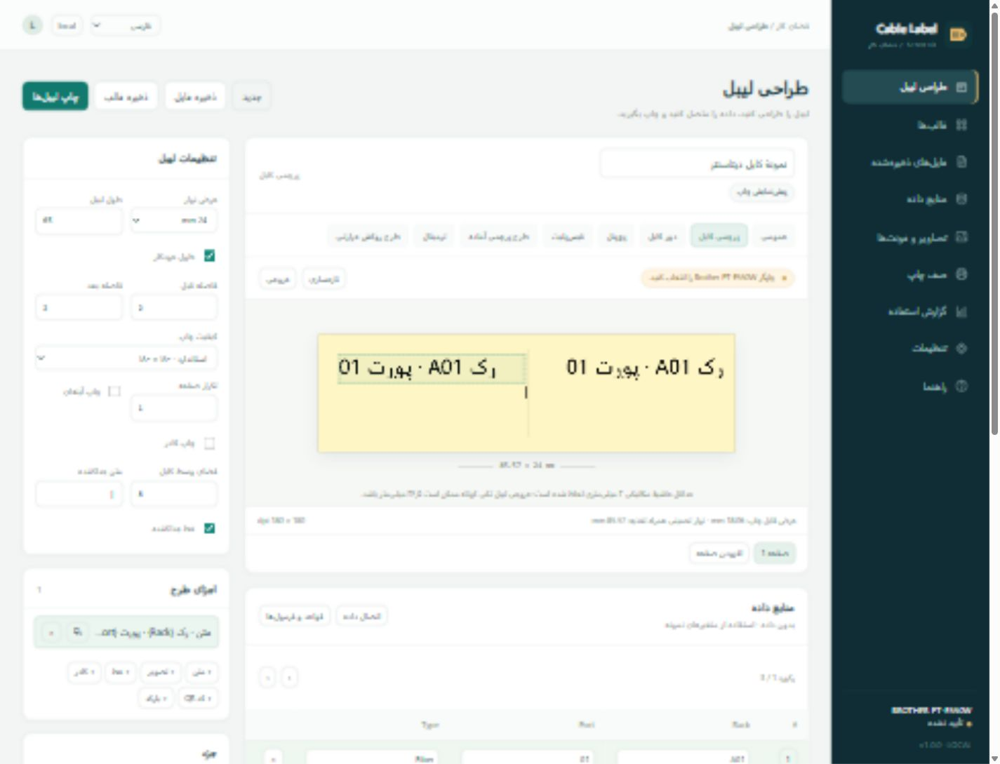

# Cable Label Studio 1.0.0

Windows local web application for Brother PT-E550W. Runs offline, stores information locally, and opens in a browser.

- [راهنمای فارسی](README.fa.md)
- [English guide](README.en.md)
- [الدليل العربي](README.ar.md)
- [Requirements and verification record](ACCEPTANCE.md)

## Download / دانلود / التنزيل

- [Windows x64 installer / نصب‌کننده / المثبّت](https://github.com/aa70027/P-touch/releases/download/v1.0.0/CableLabelStudio-1.0.0-Setup.exe)
- [Portable ZIP / نسخه بدون نصب / النسخة المحمولة](https://github.com/aa70027/P-touch/releases/download/v1.0.0/CableLabelStudio-1.0.0-Portable.zip)
- [Source package / سورس / الشفرة المصدرية](https://github.com/aa70027/P-touch/releases/download/v1.0.0/CableLabelStudio-1.0.0-Source.zip)
- [SHA-256 checksums](https://github.com/aa70027/P-touch/releases/download/v1.0.0/SHA256SUMS.txt)

Run the installer, then launch **Cable Label Studio** from the desktop or Start menu. The default URL is `http://127.0.0.1:8765`. No username or password is required initially.

The application and setup are Windows x64 builds. Python is bundled. The setup wizard uses the Windows .NET Framework 4.7.2+ runtime supplied with current Windows 10/11 installations. USB requires the Brother PT-E550W Windows driver. Access import requires a matching 64-bit Microsoft Access Database Engine / Access Runtime driver. Both prerequisites are diagnosed in Settings and are not silently installed.

Physical-device acceptance is pending: the development machine has no installed Brother driver or attached PT-E550W. Simulation, software tests and installer tests are distinct from hardware validation. See `ACCEPTANCE.md`.

## قابلیت‌ها / Features / الميزات

طراحی سه‌زبانهٔ لیبل، چاپ USB و Wi-Fi، قالب‌های کابل و پچ‌پنل، ورود Excel و Access، فرمول‌های شرطی، مدیریت کاربران و گزارش چاپ.

Trilingual label designer, USB/Wi-Fi submission, cable and patch-panel layouts, Excel/Access import, conditional rules, accounts and usage reports.

تصميم ملصقات بثلاث لغات، إرسال عبر USB وWi-Fi، قوالب الكابلات ولوحات التوصيل، استيراد Excel وAccess، قواعد شرطية وحسابات وتقارير.

63 software tests and 20 Windows package/integration checks passed. Physical-printer acceptance is still pending. [Validation details](ACCEPTANCE.md).



## Development

```powershell
python -m venv .venv
.\.venv\Scripts\python.exe -m pip install -r requirements-dev.txt
.\.venv\Scripts\python.exe run.py --no-browser
.\.venv\Scripts\python.exe -m pytest -q
.\.venv\Scripts\python.exe build.py
```

The build uses PyInstaller and the Windows Framework C# compiler at `%WINDIR%\Microsoft.NET\Framework64\v4.0.30319\csc.exe`. No Node/npm build is needed. Do not commit runtime data, print content or uploads. `run.py --data-dir PATH --port 8766 --no-browser` provides an isolated QA instance. `run.py --data-dir PATH --stop` stops that instance.

## Source structure

`labelstudio/app.py`: local API and access checks; `store.py`: SQLite, accounts and resources; `formulas.py`: bounded expression evaluator; `render.py`: shared print/preview renderer; `printer.py`: PT-E550W raster encoding, TCP and Windows RAW; `jobs.py`: serial queue and record gates; `web/`: offline trilingual interface; `installer/Setup.cs`: offline install/repair/update/uninstall wizard; `tests/`: integration and protocol checks.

The application is an independent project, not a Brother product. It uses its own `.label.json` document format; native P-touch `.lbx` import/export is not implemented.
