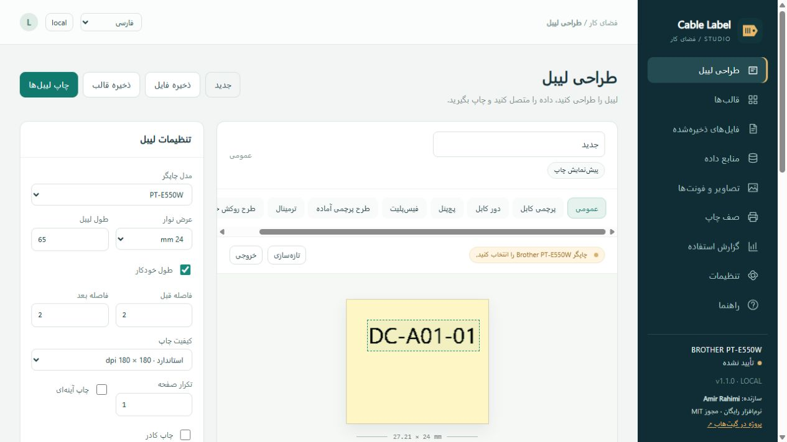

# Cable Label Studio · P-touch

**Amir Rahimi** · Free / رایگان / مجاني · [MIT](LICENSE.txt)

نرم افزار پیشرفته طراحی و چاپ لیبل برای ویندوز، با رابط فارسی، انگلیسی و عربی؛ اتصال USB/Wi-Fi، Excel چندشیتی و مسیر زنده، طراحی لیبل کابل، قواعد شرطی، مدیریت کاربران و گزارش چاپ.

Advanced local Windows label designer and printing software for Brother printers: USB/Wi-Fi, multi-sheet/live-path Excel, Access, cable layouts, rules, users, reports and GitHub updates. فارسی / English / العربية

برنامج متقدم لتصميم الملصقات وطباعتها محلياً في Windows، بثلاث لغات، مع Excel متعدد الأوراق واتصال مباشر بالملف وتقارير وتحديثات GitHub.

## Download / دانلود / التنزيل

- [Windows x64 installer](https://github.com/aa70027/P-touch/releases/download/v1.1.0/CableLabelStudio-1.1.0-Setup.exe)
- [Portable ZIP](https://github.com/aa70027/P-touch/releases/download/v1.1.0/CableLabelStudio-1.1.0-Portable.zip)
- [Editable source](https://github.com/aa70027/P-touch/releases/download/v1.1.0/CableLabelStudio-1.1.0-Source.zip)
- [SHA-256 checksums](https://github.com/aa70027/P-touch/releases/download/v1.1.0/SHA256SUMS.txt)

Install the package, choose فارسی / English / العربية on the first screen and launch Cable Label Studio. The browser opens a loopback-only local app. No login is required initially; authentication can be enabled in Settings.

## Guides / راهنما / الأدلة

- [فارسی](README.fa.md)
- [English](README.en.md)
- [العربية](README.ar.md)
- [Release checklist and hardware limitations](NEXT_UPDATE.md)
- [Requirements and validation](ACCEPTANCE.md)

PT-E550W/P750W/P710BT use model-specific Raster profiles. P700, P900W, P950NW and listed QL models use the official Brother Windows driver; cutter/media settings remain in that driver. The generic driver profile requires manual model/media verification. Physical-printer acceptance remains pending; simulations and spool submission are not physical completion.

## Development

Windows x64, Python 3.12. Create a virtual environment, install requirements-dev.txt and run `python run.py`. Run `python -m pytest tests/test_core.py tests/test_update.py -q`. Build offline packages with `python build.py`; package the allowlisted source with `python package_source.py`. No remote hosting service or cloud account is required for normal printing.

User data: `%LOCALAPPDATA%\CableLabelStudio`. Installer maintenance preserves it. Linked Excel files remain external and require a separate backup. The executable is unsigned. Brother driver/software licenses are separate from this project's MIT license.
